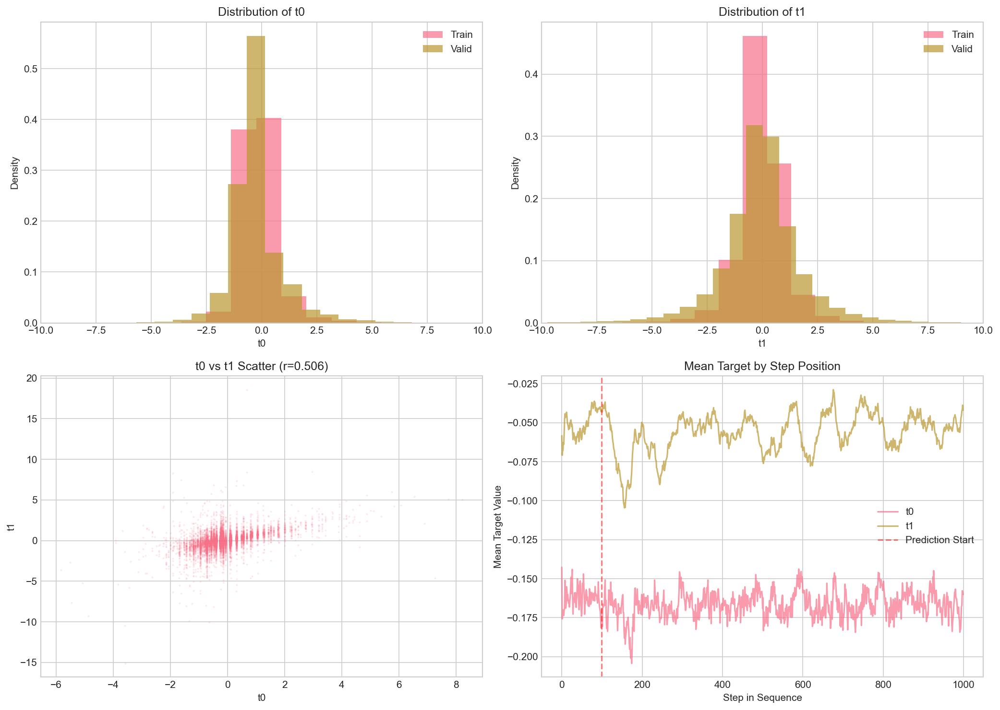

# LOB Fairy Pred

My experiments for Wunder Fund's [Wunder Challenge: LOB Predictorium](https://wundernn.io/predictorium/docs/quick_start) (December 2025 – March 2026): predicting two anonymized price-movement indicators from limit order book (LOB) sequences, with inference streamed one snapshot at a time on a single CPU core.

This repo is a record of exploration rather than a polished solution. Over about four weeks I went through six model iterations. None of my submissions beat the organizer's baseline.

## The challenge

Each sequence has 1,000 steps. Each step is one LOB snapshot plus recent trades, given as 32 anonymized features: bid/ask prices `p0`–`p11`, bid/ask volumes `v0`–`v11`, and trade prices and volumes `dp0`–`dp3` and `dv0`–`dv3`. The model predicts two targets, `t0` and `t1`, at steps 99–999. Steps 0–98 are warm-up. Sequences are independent, so the model's state resets whenever `seq_ix` changes.

Scoring is a weighted Pearson correlation averaged over the two targets, with samples weighted by `|target|` and predictions clipped to `[-6, 6]`. Submissions are a `solution.py` that the organizers call once per row, offline, with **1 vCPU, 16 GB RAM and 60 minutes** for about 1.5M rows. Full details are in the [data overview](https://wundernn.io/predictorium/docs/data_overview) and the [submission guide](https://wundernn.io/predictorium/docs/submission_guide).

## Results

| | Public leaderboard |
|---|:---:|
| 1st place | 0.32397 |
| **My best (6 submissions, as `pranay212`)** | **0.27608** (278th of 607) |

I didn't keep a log of which iteration produced which score, so I can't break the result down by model.

## What I tried

Only the final iteration is in this repo. The earlier ones are summarized from my commit history.

1. **Mamba-2 port** (late Jan 2026): an adaptation of [mamba2-minimal](https://github.com/tommyip/mamba2-minimal) with amplitude-weighted MSE and weighted-Pearson losses, ONNX export and dynamic UInt8 quantization.
2. **Rewritten Mamba-2 block:** causal depthwise convolution, a selective scan and RMSNorm, scaled up to 256 dimensions and 6 layers.
3. **Stateful GRU** (early Feb): an MLP encoder, a 2-layer GRU and an MLP head, trained on full sequences with 3 extra book features.
4. **Attentive GRU:** 50 input features (microprice, imbalances, deltas, rolling statistics), self-attention during training only, separate `t0` and `t1` heads, and a mixed MSE and correlation loss.
5. **Stateful GRU without attention**, so that training and step-by-step inference used the same network.
6. **Gated recurrence on 128-step windows** (mid-Feb, [`solution/`](solution/)): about 557k parameters.
   - **Inputs (69 per step):** the raw features, their step-to-step changes, three book proxies (imbalance, spread, total volume) and a position encoding.
   - **Model:** four gated recurrent blocks with 128-dimensional state, updated as `h = a·h + (1 − a)·u` with an input-dependent decay `a`, followed by separate `t0` and `t1` heads.
   - **Training:** random windows from one sequence-grouped fold, a weighted-correlation loss on signed-log targets.
   - **Inference:** one step exported to ONNX, with the state carried through each whole sequence.

[`DESIGN.md`](DESIGN.md) has the details of iteration 6.

## What went wrong

These are my best guesses. I never ran ablations to test them.

- **Training and inference saw different contexts.** Iteration 6 trains on 128-step windows starting from a zero state, but at test time the state runs uninterrupted for up to 1,000 steps.
- **The loss wasn't the metric.** The loss is a correlation on `sign(y)·log1p(|y|)`, but the metric weights and clips on the raw scale. The targets are heavy-tailed (kurtosis 64 for `t0` and 38 for `t1`), so the two can disagree.
- **Validation was weak.** Epoch validation sampled random windows, and I never kept full streaming scores on `valid.parquet`. I also didn't train on `valid.parquet`, although the organizers allowed it and its targets are noticeably wider than train's.
- **I went wide instead of deep.** I rewrote the model five times in a month and never tuned any version. Tuning one simple GRU would probably have done better.

## Repository layout

```
solution/
  mamba2_lob.py      Model, feature builders, target transform, loss
  train_mamba2.py    Data loading, grouped fold, windowed training, checkpoints
  export_onnx.py     Exports one recurrent step to ONNX
  solution.py        Streaming PredictionModel + local validation entry point
  README.md          Run guide
DESIGN.md            Design notes and validation caveats for the final model
eda_analysis.py      EDA script (eda_output.txt and eda_outputs/ hold my saved results)
requirements.txt     Packages needed to run this code
```

## Running the code

Neither the competition data nor the organizers' `utils.py` is included. Both come with the starter pack after you sign up on the [challenge site](https://wundernn.io/predictorium/docs/quick_start). Put the data in `datasets/` and `utils.py` in the repo root. No trained checkpoints are included either.

```bash
pip install -r requirements.txt
python solution/train_mamba2.py --train-path datasets/train.parquet --out-dir checkpoints/mamba2_lob
python solution/export_onnx.py --checkpoint checkpoints/mamba2_lob/best.pt --out-dir solution --exporter legacy
python solution/solution.py        # streams datasets/valid.parquet and prints the score
```

[`solution/README.md`](solution/README.md) has the full guide, covering the options, packaging the submission and what I've verified.



## License

MIT (see [LICENSE](LICENSE)). The competition data, the starter pack and the baseline belong to Wunder Fund and aren't redistributed here.
